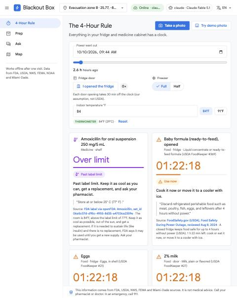
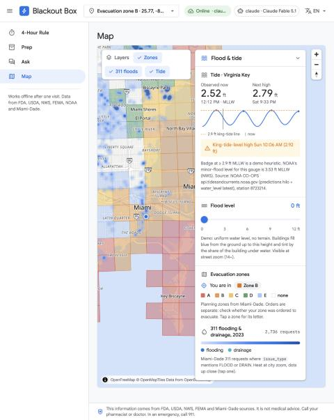

# Blackout Box

**The hurricane app that keeps working when the power and the signal don't.**

Built at **Hack for Humanity: Miami** (The AI Collective × MLH Hacktoberfest), Saturday October 10, 2026.

- **Track:** Build for Miami, **01 Four Forces, One City**. Forces: **water** (storm surge, king tides) and **fire** (extreme heat during outages).
- **Also entered:** MLH **Best Open-Source AI Project**, through the open Agent Skill in [`skills/blackout-box/`](skills/blackout-box/).
- **Live:** **https://blackoutbox.micahberkley.com** (one Cloudflare Worker: `web/dist` as static assets plus the `server/` Express API under `nodejs_compat`; Claude through the Workers AI binding and AI Gateway). Deploy steps: [`worker/README.md`](worker/README.md).



## The problem

After a hurricane, Miami can lose power for days in 90°F heat. The people hit hardest are seniors on insulin, families with baby formula, and Spanish and Haitian Creole speakers who get the least official information in their language. Nobody can tell them whether the food in the fridge or the insulin pen in the drawer is still safe, and the apps that could tell them stop working when the internet does.

## What it does

1. **Prep (before the storm, online).** "Pack my box" saves to the device: your Miami-Dade evacuation zone, nearby places likely to have power (EV chargers, libraries, fire stations), Miami-Dade disaster declarations, the live NWS heat index, Florida's emergency prescription refill law (F.S. 252.358), FDA emergency insulin guidance, and the USDA power-outage food rules.
2. **The 4-Hour Rule (after the power goes out).** Photograph your fridge and medicine cabinet. Claude reads every item. Our open rules engine gives each one a live countdown with SAFE / USE NOW / DISCARD / PAST LABEL LIMIT, and every number cites its source: the FoodSafety.gov power-outage chart, the USDA FoodKeeper table, or the drug's FDA label from openFDA. Tap "I opened the fridge" and the clocks shorten. Enter the room temperature and medicine clocks follow the label's limit.
3. **Ask.** Questions in English, Spanish or Haitian Creole, answered from the saved box. If someone mentions a downed wire, gas smell, chest pain or trouble breathing, the answer starts with "Call 911."
4. **Closest shelter.** The nearest hurricane shelters from FEMA's shelter system, open or not, with one-tap directions.
5. **Map.** All 2,147 Miami-Dade evacuation-zone polygons, 2,736 flooding and drainage 311 requests from 2023 as a heatmap, the live NOAA tide at Virginia Key with king-tide flags, and a 0–12 ft flood slider that fills buildings from the ground up.

**Offline:** it's a PWA. After one visit, the app, your saved box and every countdown keep working with no network. The countdown engine runs on the device with no model. Only reading a new photo and free-form questions need a connection.



## How AI and data are used (and how you can check them)

| Step | What does the work | How to verify |
| --- | --- | --- |
| Read a fridge / freezer / medicine photo | **Gemini 3.5 Flash** (`google/gemini-3.5-flash`, minimal reasoning, ~3 s) via Cloudflare AI Gateway, strict JSON item list | The sample-photo sheet scans real photos on stage; items appear as chips |
| Decide how long each item has | **Open rules engine**, no model: [`modules/four-hour-rule`](modules/four-hour-rule) (63 tests) | Each card quotes its rule and links the source (FoodSafety.gov chart row, FoodKeeper ID, or openFDA set ID) |
| Answer questions | **Claude Fable 5.1** (`anthropic/claude-fable-5.1`), falls back to Sonnet 5.5 | Answers list their sources; a server-side filter blocks dosing advice and "safe to use" claims about medicine |
| Translate to Spanish and Haitian Creole | **Gemma 4** (`@cf/google/gemma-4-26b-a4b-it`, open weights, Workers AI through Cloudflare AI Gateway), falls back to Claude | `POST /api/translate` returns `_model` |

The model never invents a number. It turns a photo into item names; the engine turns names and labels into clocks.

## Data sources

| Source | Used for | License / terms |
| --- | --- | --- |
| [FoodSafety.gov: Food safety during a power outage](https://www.foodsafety.gov/food-safety-charts/food-safety-during-power-outage) | 4-hour fridge rule, 48 h / 24 h freezer rule, keep/discard chart | US government work |
| [USDA FSIS FoodKeeper data](https://catalog.data.gov/dataset/fsis-foodkeeper-data) (v128) | Food storage times for 661 products, bundled in [`data/foodkeeper.json`](data/foodkeeper.json) | CC0 |
| [openFDA drug label API](https://open.fda.gov/apis/drug/label/) | Storage temperature and in-use days from each drug's label | CC0 ([terms](https://open.fda.gov/terms/)) |
| [FDA: Insulin storage and switching in an emergency](https://www.fda.gov/drugs/emergency-preparedness-drugs/information-regarding-insulin-storage-and-switching-between-products-emergency) | Emergency insulin guidance | US government work |
| [Florida Statutes 252.358](https://www.flsenate.gov/Laws/Statutes/2025/252.358) | Emergency prescription refills | Public law |
| [National Weather Service API](https://www.weather.gov/documentation/services-web-api) | Current temperature, heat index, hourly forecast (KMIA) | Public domain |
| [Miami-Dade County Open Data Hub](https://gis-mdc.opendata.arcgis.com) | Hurricane evacuation zones, libraries, fire stations, 311 service requests 2023 | Miami-Dade open data terms |
| [OpenFEMA Disaster Declarations Summaries v2](https://www.fema.gov/about/openfema/data-sets) | Miami-Dade disaster declarations | Public domain |
| [NOAA CO-OPS](https://tidesandcurrents.noaa.gov/stationhome.html?id=8723214) station 8723214 Virginia Key | Tide predictions, observed water level, flood thresholds | Public domain |
| [FEMA ESF#6 Shelter System (NSS)](https://gis.fema.gov/arcgis/rest/services/NSS/FEMA_NSS/MapServer) | Nearest hurricane shelters, open status | Public domain |
| [National Hurricane Center CurrentStorms.json](https://www.nhc.noaa.gov/CurrentStorms.json) | Active storms, distance and movement | Public domain |
| [Open-Meteo](https://open-meteo.com) | UV, wind, rain chance, air quality, sunrise/sunset | CC BY 4.0 |
| [AWS Terrain Tiles](https://registry.opendata.aws/terrain-tiles/) | Ground elevation for the flood map | Public / open data |
| [NREL / NLR Alternative Fuel Stations API](https://developer.nlr.gov/docs/transportation/alt-fuel-stations-v1/) | EV chargers as places likely to have power | Public domain |
| [OpenFreeMap](https://openfreemap.org) / OpenMapTiles / OpenStreetMap | Basemap and building footprints | ODbL / OpenMapTiles license |

## Run it

Requires Node 20+.

```bash
# 1. API server (port 3001)
cd server && npm install
cp ../.env.example .env   # fill in CF_ACCOUNT_ID, CF_API_TOKEN, DATA_GOV_API_KEY
npm start
# No keys? Every route works from recorded real responses:
DEMO_MODE=1 npm start

# 2. Web app (port 5173, proxies /api to 3001)
cd web && npm install
npm run dev          # or: npm run build && npx vite preview --port 5173

# 3. Engine tests
cd modules/four-hour-rule && npm install && npm test
```

## The open-source AI piece: `blackout-box` Agent Skill

[`skills/blackout-box/`](skills/blackout-box/) follows the [Agent Skills open standard](https://agentskills.io/specification). Any agent (Claude Code, Codex, others) can use it to answer "is this food or medicine still safe after the outage, and for how long?" It runs offline with no model and no key:

```bash
node skills/blackout-box/scripts/assess.mjs skills/blackout-box/assets/example-input.json
```

## Safety

Blackout Box gives information from FDA, USDA, NWS, FEMA and Miami-Dade sources. It is not medical advice. It never tells anyone to change a dose, and when a medicine passes its label limit it says to keep it cool, get a replacement and call a pharmacist; for insulin it follows FDA's emergency guidance to keep using it only until a new supply is available. In an emergency, call 911.

Spanish and Haitian Creole strings marked `// MT` in [`web/src/i18n.ts`](web/src/i18n.ts) are machine translations and need review by a native speaker.

## Built with

- TypeScript, Vite, vite-plugin-pwa (Workbox), IndexedDB (`idb`), MapLibre GL, Express.
- Models: Gemini 3.5 Flash (photo reading), Claude Fable 5.1 (questions) and Gemma 4 26B (Spanish / Haitian Creole translation, open weights on Workers AI) through Cloudflare AI Gateway. Images: Grok Imagine (hero scenes, 3D icons, app icon, sample photos).
- AI tools used to build it: Claude Code (Claude Fable 5.1 and Claude Opus 5.5 as coordinator; four Claude Opus 5.5 build agents for the engine, server, web app and map).

## Team

- Micah Berkley

## License

[MIT](LICENSE)
